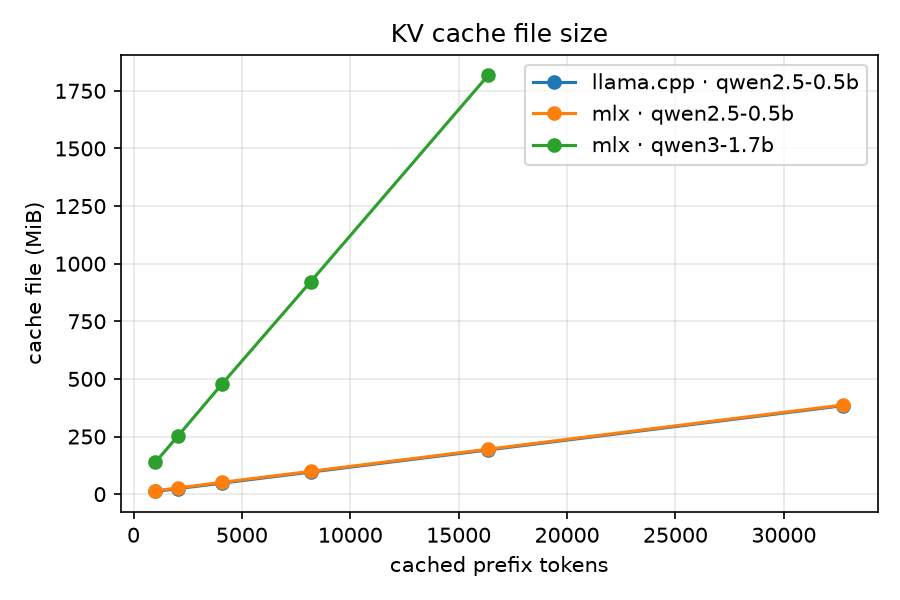
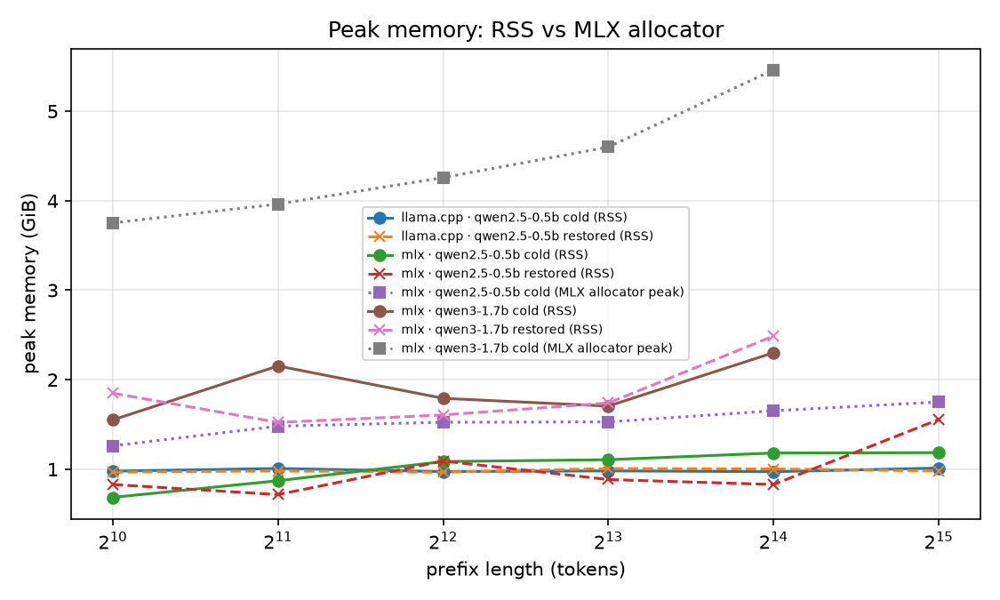

# KV Lab

**Compute a long prompt's KV cache once, save it, and restore it in a new process (or on another machine): up to 207× faster time to first token on a MacBook.**


## The idea

Before a language model writes its first token, it must *prefill* the prompt:
run every prompt token through every layer and store the attention keys and
values (the **KV cache**). Prefill cost grows faster than linearly with prompt
length. For a long shared context (a document, a codebase, a system prompt with
tools), most of the wait before the first token is spent recomputing the same
KV cache.

KV-cache transfer treats that cache as a file:

1. prefill the long prefix **once**, then serialize its KV tensors,
2. **restore** them in a fresh process, or copy them to another machine,
3. compute only the new tokens (the user's question).

This repo measures whether that pays off on Apple Silicon with two local
engines, and how close a restored cache is to a cache that never left memory.

* **llama.cpp:** `llama-server --slot-save-path`, `POST /slots/0?action=save` / `?action=restore`
* **MLX:** `mlx_lm.models.cache.save_prompt_cache` / `load_prompt_cache` (safetensors)

## Method

For each prefix length (1k, 2k, 4k, 8k, 16k, 32k tokens), 3 repeats, median reported:

| condition | what happens |
|---|---|
| **cold** | fresh process, nothing cached: prefill prefix + question, generate |
| **warm** | same process, prefix KV still in memory (ordinary prefix caching, the best case) |
| **restored** | a *different* fresh process loads the saved KV file, then gets prefix + question; only the question is computed |

The metrics are time to first token (TTFT), total latency, restore/load time,
cache file size, peak memory (process RSS plus MLX's allocator peak), and
transfer time over localhost HTTP with SHA-256 checks. Output equality is
checked token for token under greedy decoding.

* **Prompt:** a synthetic reference document of N records plus a question about
  one record about 60 % of the way in, which doubles as a needle-in-a-haystack
  check. Token IDs are generated once (`results/prompts/`) so both engines see
  identical tokens.
* **Fairness:** both engines warm up before timing, so one-time Metal kernel
  compilation is not counted in TTFT, and model load time is excluded.
  `--cache-ram 0` and `-np 1` keep llama.cpp from caching anything behind our back.
* **Shared-machine guard:** each MLX phase times a fixed matmul probe before and
  after its measurement and is re-run if the GPU was busy with another job.

## Hardware and software

| | |
|---|---|
| Machine | Apple M5, 16 GB unified memory, macOS 27.0.1 |
| llama.cpp | Homebrew `llama-server` build 10809, Metal, flash attention on |
| MLX | mlx 0.32.4, mlx-lm 0.32.2 |
| Models | **Qwen2.5-0.5B-Instruct** (GGUF Q8_0 for llama.cpp, bf16 for MLX) and **Qwen3-1.7B** (bf16, MLX) |
| Python | 3.12 via `uv` |

## Results

| engine · model | prefix | cold TTFT | restored TTFT (incl. load) | speedup | cache file | restored = in-memory cache |
|---|---:|---:|---:|---:|---:|---:|
| llama.cpp · Qwen2.5-0.5B | 4k | 711 ms | 32 ms | 22× | 48 MiB | 3/3 |
| llama.cpp · Qwen2.5-0.5B | 16k | 6.66 s | 74 ms | **90×** | 192 MiB | 3/3 |
| llama.cpp · Qwen2.5-0.5B | 32k | 24.8 s | 120 ms | **207×** | 384 MiB | 3/3 |
| MLX · Qwen2.5-0.5B | 16k | 2.03 s | 64 ms | 32× | 195 MiB | 3/3 |
| MLX · Qwen2.5-0.5B | 32k | 6.35 s | 89 ms | **72×** | 387 MiB | 3/3 |
| MLX · Qwen3-1.7B | 4k | 1.20 s | 268 ms | 4.5× | 476 MiB | 3/3 |
| MLX · Qwen3-1.7B | 16k | 6.89 s | 1.04 s | 6.6× | 1.8 GiB | 3/3 |

The full table (every length, warm TTFT, memory) is in
[reports/kv_transfer.md](reports/kv_transfer.md), and the raw numbers are in
[results/](results/).

* **Speedup grows with context length.** Cold prefill grows faster than
  linearly; restored TTFT stays nearly flat, because only the 22 question
  tokens are computed.
* **Restoring is cheap.** A 384 MiB slot loads in 48 ms (llama.cpp); a 1.8 GiB
  MLX cache loads in 0.57 s. Restored TTFT is within a few ms of the in-memory
  warm cache.
* **Correctness.** The restored cache gave the same greedy output as the
  in-memory cache in **51/51** runs, and the same output as full recomputation
  in **48/51**. The three exceptions are Qwen3-1.7B at 16k, where splitting
  the prompt into chunks differently changes bf16 rounding and greedy decoding
  flips between two near-equal choices.
* **Memory.** Restored runs peak 0.4 to 0.5 GiB lower than cold runs (no
  prefill activations).
* **Shipping it.** Copying between processes over localhost HTTP ran at about
  2.0 to 2.7 GB/s. Transfer beats recomputing on any link faster than **0.1 to
  0.8 Gbit/s** (0.5B) or **2.6 to 5.8 Gbit/s** (1.7B, which has 9× more KV per
  token). zstd only compresses KV files 1.1 to 1.6×.


| | |
|---|---|
|  |  |

## Reproduce

Requirements: an Apple Silicon Mac, [uv](https://docs.astral.sh/uv/), and
Homebrew llama.cpp.

```bash
brew install llama.cpp
```

```bash
git clone https://github.com/Eyad8588/kv-lab.git && cd kv-lab
```

```bash
uv sync
```

```bash
make fetch
```

`make fetch` downloads only the models that are missing (Qwen2.5-0.5B-Instruct
GGUF + HF, Qwen3-1.7B HF; about 5 GB at most). It checks the LM Studio folder
and the Hugging Face cache first.

```bash
make bench
```

`make bench` runs the llama.cpp sweep, the MLX sweep, the transfer test and the
report: about 30 minutes on an M5. It writes `results/*.csv` and `reports/*.png`.

```bash
make quick
```

`make quick` is a smoke test: 1k + 4k tokens, one repeat.

To run individual steps:

```bash
uv run kvlab llama --fresh --lengths 1024 4096 16384 32768 --repeats 3 --models qwen2.5-0.5b
```

```bash
uv run kvlab mlx --fresh --lengths 1024 4096 16384 --repeats 3 --models qwen2.5-0.5b qwen3-1.7b
```

```bash
uv run kvlab transfer --fresh --repeats 3
```

```bash
uv run kvlab report
```

Saved caches go to `cache/` (git-ignored). `make clean` removes them.

## Limitations

* **One machine.** The "transfer" step is process-to-process over localhost
  HTTP; real link speeds are projected from the measured numbers, not measured
  on a NIC.
* **Small models.** Qwen2.5-0.5B and Qwen3-1.7B were chosen to fit next to other
  workloads in 16 GB and to avoid large downloads. They fail the needle question
  beyond 1 to 2k tokens, and they give the *same* wrong answer cold and
  restored. The cache affects speed, not what the model knows.
* **Different weight formats per engine** (Q8_0 for llama.cpp vs bf16 for MLX),
  so this is not a head-to-head engine benchmark.
* **Warm page cache.** The restored process reads a file that was just written.
  A cold SSD read adds roughly `size / 5 GB/s`.
* **Shared, busy machine.** Other AI jobs ran during the runs. MLX phases were
  retried when the GPU was busy; llama.cpp had one cold outlier at 2k and one
  at 4k, which the medians absorb.
* **Exact model match required.** A KV cache is valid only for the same
  weights, tokenizer, RoPE config and token prefix. MLX does not enforce this.
* **Not covered:** quantized KV (`--cache-type-k q8_0`), hybrid or recurrent
  models (fixed-size state instead of per-token KV), and partial-prefix reuse.

## Extending to vLLM + LMCache on an NVIDIA GPU (design only)

| this lab | GPU equivalent |
|---|---|
| llama.cpp slot / MLX prompt cache | vLLM paged KV blocks + Automatic Prefix Caching (in-process "warm") |
| `action=save` / `save_prompt_cache` | **LMCache** connector (`--kv-transfer-config`), offloading to CPU RAM, disk, Redis/Valkey or Mooncake |
| restore in a new process | a new vLLM instance on the same LMCache backend pulls matching 256-token chunks |
| localhost HTTP copy | NIXL / UCX over RDMA (InfiniBand, RoCE), or TCP to a shared cache server |

The plan:

1. vLLM baseline (APC on), cold vs warm.
2. LMCache with CPU and disk offload across vLLM restarts.
3. Disaggregated prefill/decode with NIXL, sweeping NVLink, InfiniBand and 25 GbE.
4. A shared LMCache tier for several replicas, replaying a RAG workload (hit
   rate, p50/p95 TTFT, GPU-seconds saved).
5. Greedy-equality and QA checks, including FP8 KV.

GPUs prefill 10 to 50× faster than an M5, so the break-even link speed rises by
the same factor. Cross-node KV transfer needs RDMA-class bandwidth; TCP mostly
pays off for very long contexts or for reloading from local CPU RAM or NVMe.
Section 7 of the [report](reports/kv_transfer.md) has the details.

## Project structure

```
kv-lab/
├── Makefile                 make fetch | bench | quick | report | clean
├── pyproject.toml           uv project, `kvlab` CLI entry point
├── src/kvlab/
│   ├── cli.py               kvlab {fetch,llama,mlx,transfer,report,all}
│   ├── models.py            model registry: GGUF/HF locations, KV geometry
│   ├── prompts.py           deterministic long prompts, cached token IDs
│   ├── llama_bench.py       llama-server: cold → save slot → kill → new server → restore → query
│   ├── mlx_worker.py        one MLX phase per process (cold / save+warm / restore)
│   ├── mlx_bench.py         drives MLX phases, GPU-contention guard
│   ├── transfer.py          HTTP transfer of cache files + SHA-256 + zstd
│   ├── report.py            medians → summary.csv, charts, generated tables
│   └── common.py            timing, peak-RSS sampler, CSV helpers
├── results/                 llama_runs.csv, mlx_runs.csv, transfer_runs.csv, summary.csv, prompts/
├── reports/                 kv_transfer.md (full write-up), *.png charts, _generated_tables.md
└── cache/                   saved KV files (git-ignored)
```

## Screenshots

- TODO: terminal recording of `make quick` (cold vs restored lines)
- TODO: llama-server log showing `prompt_n = 22` after a slot restore
- TODO: the TTFT chart as shown on the portfolio page
