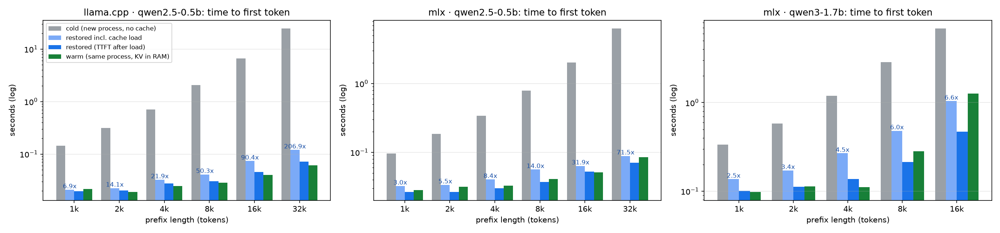

# KV Lab — KV-cache transfer on a Mac

Compute the attention KV cache for a long prompt **once**, save it to a file,
restore it in a **brand-new process** (or ship it to another machine), and
measure what that buys you. Two engines, same idea:

* **llama.cpp** — `llama-server --slot-save-path`, then `POST /slots/0?action=save|restore`
* **MLX** — `mlx_lm` `save_prompt_cache` / `load_prompt_cache` (safetensors)

The full write-up with charts is in **[reports/kv_transfer.md](reports/kv_transfer.md)**.

**Headline (Apple M5, 16 GB):** a 32k-token prompt took **24.8 s** to first token
cold in llama.cpp and **0.12 s** when its saved KV cache was restored in a fresh
process (**207×**, 384 MiB file). In MLX it was 6.35 s vs 0.089 s (72×). The
restored cache gave greedy output identical to the in-memory cache in 51/51
runs, and identical to recomputation in 48/51. Shipping the cache beats
recomputing it on any link faster than 0.1 to 6 Gbit/s, depending on the model.



## What is measured

For each prompt length (1k → 32k tokens), repeated 3× (medians reported):

| metric | how |
|---|---|
| **cold TTFT** | fresh process, no cache, prefix + question |
| **restored TTFT** | *another* fresh process restores the saved prefix KV, then gets the same prefix + question |
| restore / load time | `restore_ms` from llama-server; `load_prompt_cache` wall time in MLX |
| warm TTFT | same process, KV still in memory (the best case, i.e. normal prefix caching) |
| total latency | prompt → last generated token (greedy, ≤24 tokens) |
| memory | peak RSS of the engine process (sampled with `ps`), plus MLX's own peak allocator figure (more reliable on macOS) |
| cache file size | bytes on disk, and KiB per token |
| transfer | the cache files are served over HTTP on localhost and downloaded by another process; SHA-256 verified; zstd compressibility |
| correctness | greedy output of the restored run compared **token-for-token** with the cold run and with the in-memory warm run; answer checked against the expected access code |

MLX phases are protected by a **GPU contention guard**: a fixed matmul probe runs
before and after each timed phase, and the phase is re-run if the GPU was busy.
This matters on a shared machine.

The prompt is a synthetic "reference document" of N records plus a question about
one record (≈60 % into the document), so every run is also a needle-in-a-haystack
accuracy check. Token IDs are built once and cached in `results/prompts/` so both
engines see **identical token IDs**.

## Reproduce

Requirements: Apple Silicon Mac, [uv](https://docs.astral.sh/uv/), Homebrew `llama.cpp`
(`brew install llama.cpp`, provides `llama-server`).

```bash
uv sync                 # Python 3.12 + mlx-lm, pandas, matplotlib, ...
```

```bash
make fetch              # downloads only missing models (Qwen2.5-0.5B-Instruct GGUF + HF, Qwen3-1.7B HF; ~5 GB worst case)
```

```bash
make bench              # llama.cpp sweep, MLX sweep, transfer, report (~20-30 min)
```

```bash
make quick              # smoke test: 1k + 4k tokens, one repeat
```

Individual steps (all write to `results/*.csv`, charts to `reports/*.png`):

```bash
uv run kvlab llama --fresh --lengths 1024 4096 16384 --repeats 3 --models qwen2.5-0.5b
```

```bash
uv run kvlab mlx --fresh --lengths 1024 4096 16384 --repeats 3 --models qwen2.5-0.5b qwen3-1.7b
```

```bash
uv run kvlab transfer --fresh && uv run kvlab report
```

Default models: **Qwen2.5-0.5B-Instruct** on both engines (GGUF Q8_0 + HF bf16)
and **Qwen3-1.7B** on MLX. If `Qwen/Qwen3-1.7B-GGUF` is in your HF cache you can also run
`uv run kvlab llama --models qwen3-1.7b`. Models are looked up locally first (LM Studio folder, Hugging Face cache); see
`src/kvlab/models.py` to add another model.

## Layout

```
src/kvlab/
  prompts.py      deterministic long prompts, exact token budgets, cached token IDs
  models.py       model registry (GGUF + HF paths, KV geometry)
  llama_bench.py  llama-server: cold -> save slot -> kill -> new server -> restore -> query
  mlx_worker.py   one MLX phase per process (cold / save+warm / restore)
  mlx_bench.py    drives the MLX phases
  transfer.py     HTTP transfer of cache files between processes + zstd check
  report.py       medians, summary.csv, charts
results/          raw per-run CSVs, summary.csv, prompt token IDs
reports/          kv_transfer.md + charts
cache/            saved KV files (git-ignored)
```
