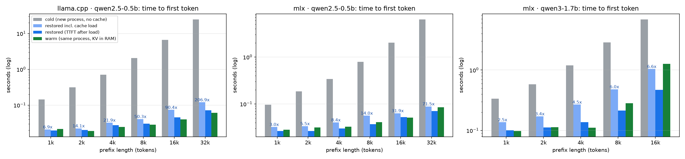
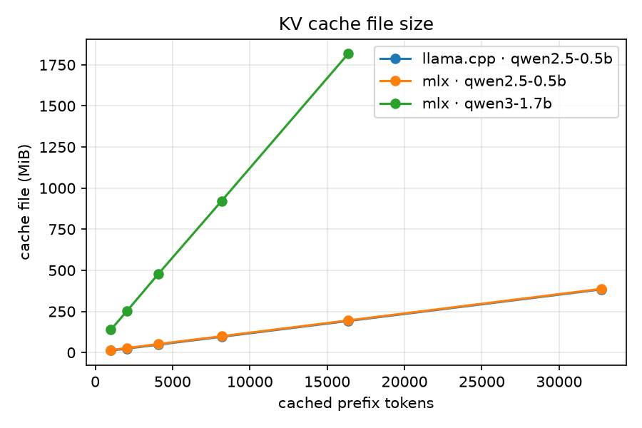
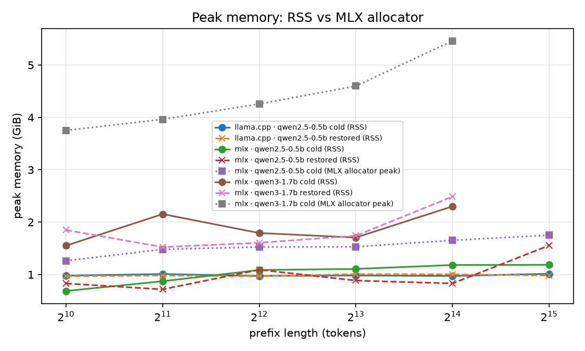
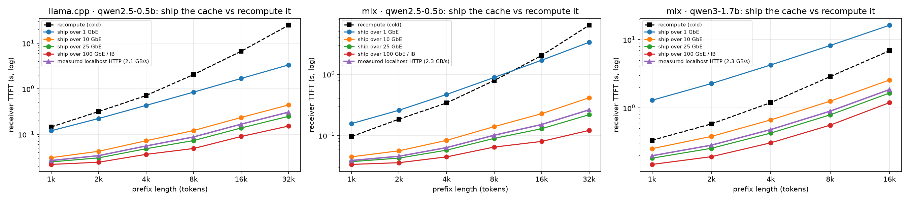

# KV-cache transfer on a Mac: compute once, restore anywhere

**KV Lab · Apple M5, 16 GB · measured 18 November 2026**

Long prompts are expensive because the model must *prefill* them: run every
prompt token through every layer to build the attention **KV cache**. This lab
tests a simple idea on a laptop. Compute that cache once, write it to a file,
then load it in a **brand-new process** (or ship it to another machine) instead
of recomputing it.

It works, by a wide margin. The restored cache gave the same greedy output as
recomputation, token for token, in every run except one configuration, and
that exception is explained below.

## Headline results

| | cold (recompute) | restored in a new process (incl. load) | speedup | cache file |
|---|---:|---:|---:|---:|
| **llama.cpp**, Qwen2.5-0.5B Q8_0, 32k-token prefix | 24.8 s | **0.12 s** | **207×** | 384 MiB |
| llama.cpp, Qwen2.5-0.5B Q8_0, 16k | 6.66 s | 0.074 s | 90× | 192 MiB |
| **MLX**, Qwen2.5-0.5B bf16, 32k | 6.35 s | **0.089 s** | **72×** | 387 MiB |
| **MLX**, Qwen3-1.7B bf16, 16k | 6.89 s | **1.04 s** | **6.6×** | 1.8 GiB |

*Time to first token (TTFT), median of 3 runs. "Restored" includes reading the cache file.*

* **Output equality:** restored output matched cold output token for token in
  **48 of 51 runs**. The three mismatches are Qwen3-1.7B at 16k. There, the
  restored output still matched the in-process warm cache 3 of 3 times, so the
  file restored exactly (details in section 4).
* **Restoring costs almost nothing:** loading 384 MiB took 48 ms in llama.cpp and
  18 ms in MLX. A 1.8 GiB MLX file took 0.57 s.
* **Restoring also saves memory:** MLX peak memory was 0.4 to 0.5 GiB *lower*
  when restoring than when recomputing (Qwen3-1.7B at 16k: 4.99 vs 5.46 GiB),
  because there is no prefill activation spike.
* **Shipping the cache is worth it on almost any link:** process-to-process
  HTTP on localhost moved the files at about 2.1 to 2.6 GB/s with SHA-256
  checks. The *break-even* link speed was 0.1 to 0.8 Gbit/s for the 0.5B model
  and 2.6 to 5.8 Gbit/s for Qwen3-1.7B. Ordinary 10 GbE beats recomputing in
  every configuration tested.
* **The cache barely compresses:** zstd-3 shrank llama.cpp files by 1.1× and MLX
  files by 1.3 to 1.6×. Fewer bytes on the wire needs quantized KV, not a
  general-purpose compressor.



## 1. Setup

| | |
|---|---|
| Hardware | Apple M5, 16 GB unified memory, macOS 27.0.1. Several other AI workloads ran on the machine during the runs (see section 6). |
| llama.cpp | Homebrew `llama-server` build 10809 (0.4.0), Metal, `-fa on -np 1 --cache-ram 0`, ctx = longest prompt + 1024 |
| MLX | mlx 0.32.4, mlx-lm 0.32.2, bf16 weights straight from the Hugging Face cache |
| Models | **Qwen2.5-0.5B-Instruct** on both engines (GGUF Q8_0 from LM Studio; HF safetensors for MLX). **Qwen3-1.7B** (thinking disabled) on MLX only. |
| Decoding | greedy (temperature 0, top-k 1), up to 24 new tokens |
| Prompt | a synthetic "reference document" of N records (`R-00042 \| team … \| access code: 4459-F94`) and a question about one record about 60 % of the way in. The document is the **prefix** that gets cached; the question is a **new suffix** that is always computed fresh. |
| Lengths | 1k, 2k, 4k, 8k, 16k, 32k prefix tokens (Qwen3-1.7B up to 16k) |
| Repeats | 3 per point; medians reported |

Both engines receive **identical token IDs**. The IDs are built once and saved
in `results/prompts/`, and the HF tokenizer round-trip check passed for every
prompt.

### What each condition means

```
COLD      new process ─ prefill(prefix + question) ─ generate
SAVE      new process ─ prefill(prefix) ─ [WARM: + question → generate, KV still in RAM] ─ write file
RESTORED  new process ─ read file → KV ─ prefill(question only) ─ generate
```

* **llama.cpp:** server A answers cold, then gets the prefix alone (so the slot
  holds exactly the prefix) and runs `POST /slots/0?action=save`. Server A is
  killed. A **new** server B runs `POST /slots/0?action=restore` and then
  receives the full prompt. Its prompt cache matches the restored prefix, so
  only the 22 question tokens are processed (`prompt_n = 22` in every restored run).
* **MLX:** each phase is a separate Python process. The prefix is prefilled into
  `make_prompt_cache`. Warm is measured, the cache is trimmed back to the prefix
  (`trim_prompt_cache`), and `save_prompt_cache` writes it to safetensors. A new
  process calls `load_prompt_cache`, which reports 1,006 to 32,735 restored
  tokens as expected, and generates from the question.
* Model load time is excluded from TTFT for every condition: both engines warm
  up first. Load time was 0.5 to 0.6 s for llama-server and 0.5 to 2.3 s for MLX.

## 2. Full results

| engine · model | prefix tok | cold TTFT | restore (load) | restored TTFT | restored+load | warm TTFT | speedup (incl. load) | cache file | restored = cold | restored = warm |
|---|---:|---:|---:|---:|---:|---:|---:|---:|---:|---:|
| llama.cpp · qwen2.5-0.5b | 1,006 | 145 ms | 1 ms | 20 ms | 21 ms | 21 ms | **6.9×** | 12 MiB | 3/3 | 3/3 |
| llama.cpp · qwen2.5-0.5b | 2,035 | 316 ms | 2 ms | 20 ms | 22 ms | 19 ms | **14.1×** | 24 MiB | 3/3 | 3/3 |
| llama.cpp · qwen2.5-0.5b | 4,065 | 711 ms | 5 ms | 27 ms | 32 ms | 25 ms | **21.9×** | 48 MiB | 3/3 | 3/3 |
| llama.cpp · qwen2.5-0.5b | 8,171 | 2,058 ms | 11 ms | 30 ms | 41 ms | 28 ms | **50.3×** | 96 MiB | 3/3 | 3/3 |
| llama.cpp · qwen2.5-0.5b | 16,360 | 6,659 ms | 28 ms | 46 ms | 74 ms | 40 ms | **90.4×** | 192 MiB | 3/3 | 3/3 |
| llama.cpp · qwen2.5-0.5b | 32,735 | 24,834 ms | 48 ms | 72 ms | 120 ms | 61 ms | **206.9×** | 384 MiB | 3/3 | 3/3 |
| mlx · qwen2.5-0.5b | 1,006 | 96 ms | 6 ms | 26 ms | 32 ms | 28 ms | **3.0×** | 15 MiB | 3/3 | 3/3 |
| mlx · qwen2.5-0.5b | 2,035 | 185 ms | 7 ms | 27 ms | 34 ms | 31 ms | **5.5×** | 27 MiB | 3/3 | 3/3 |
| mlx · qwen2.5-0.5b | 4,065 | 340 ms | 10 ms | 30 ms | 40 ms | 33 ms | **8.4×** | 51 MiB | 3/3 | 3/3 |
| mlx · qwen2.5-0.5b | 8,171 | 790 ms | 19 ms | 37 ms | 56 ms | 41 ms | **14.0×** | 99 MiB | 3/3 | 3/3 |
| mlx · qwen2.5-0.5b | 16,360 | 2,025 ms | 11 ms | 52 ms | 64 ms | 51 ms | **31.9×** | 195 MiB | 3/3 | 3/3 |
| mlx · qwen2.5-0.5b | 32,735 | 6,347 ms | 18 ms | 71 ms | 89 ms | 85 ms | **71.5×** | 387 MiB | 3/3 | 3/3 |
| mlx · qwen3-1.7b | 1,006 | 335 ms | 36 ms | 101 ms | 137 ms | 98 ms | **2.5×** | 138 MiB | 3/3 | 3/3 |
| mlx · qwen3-1.7b | 2,035 | 582 ms | 59 ms | 113 ms | 172 ms | 113 ms | **3.4×** | 251 MiB | 3/3 | 3/3 |
| mlx · qwen3-1.7b | 4,065 | 1,195 ms | 130 ms | 137 ms | 268 ms | 111 ms | **4.5×** | 476 MiB | 3/3 | 3/3 |
| mlx · qwen3-1.7b | 8,171 | 2,876 ms | 268 ms | 214 ms | 481 ms | 282 ms | **6.0×** | 922 MiB | 3/3 | 3/3 |
| mlx · qwen3-1.7b | 16,360 | 6,891 ms | 572 ms | 470 ms | 1,042 ms | 1,263 ms | **6.6×** | 1,817 MiB | **0/3** | 3/3 |

Total latency (prompt to last token) follows the same pattern. For example,
llama.cpp at 32k took 24.97 s cold and 0.19 s restored, and Qwen3-1.7B at 16k
took 8.18 s cold and 1.86 s restored. The raw data is in `results/llama_runs.csv`,
`results/mlx_runs.csv` and `results/summary.csv`.

**How to read this.** Cold TTFT grows faster than linearly with prompt length
(attention is quadratic), while restored TTFT stays almost flat: only the
22-token question is computed. The speedup therefore *grows with context
length*. A restored cache is about as fast as a cache that never left memory
(compare the "restored" and "warm" columns), so the file round-trip costs only
the read itself.

On the same 0.5B model, MLX bf16 prefilled long prompts about 4× faster than
this llama.cpp Q8_0 build (6.3 s vs 24.8 s at 32k). That makes MLX's
*relative* gain smaller, although both engines restore in under 0.1 s. This is
not a controlled engine comparison: the weight formats differ and the runs
happened at different times on a shared machine.

## 3. Cache size and memory



KV size is set by the architecture: `2 (K,V) × layers × kv_heads × head_dim × 2 bytes`.

| model | layers × KV heads × head dim | theory (fp16) | measured file |
|---|---|---:|---:|
| Qwen2.5-0.5B | 24 × 2 × 64 | 12 KiB/token | 12.0 KiB/token (llama.cpp) · 12.1 to 15 (MLX) |
| Qwen3-1.7B | 28 × 8 × 128 | 112 KiB/token | 114 to 141 KiB/token (MLX) |

llama.cpp files match theory exactly. MLX files are slightly larger at short
lengths because `save_prompt_cache` writes the cache's allocated buffer, which
is rounded up in 256-token steps. Grouped-query attention is why a 1.7B model
has **9× more KV per token** than the 0.5B model (8 vs 2 KV heads, 128 vs 64
head dim): KV size depends on the attention layout, not the parameter count.



* llama-server's RSS is flat at about 1.0 GiB for every length, because it
  allocates the KV for the whole context window at startup. Restoring into that
  buffer adds nothing.
* MLX's own allocator peak was 1.26 to 1.75 GiB cold vs 0.95 to 1.31 GiB
  restored (0.5B), and 3.75 to 5.46 vs 3.36 to 4.99 GiB (1.7B). The restored
  process never builds the prefill activations.
* On macOS, RSS undercounts Metal/unified-memory buffers under memory pressure.
  For MLX, the allocator figure is the reliable number.

## 4. Correctness: is the restored cache the same computation?

Each restored run's greedy output was compared token-for-token with the cold
run, and with the in-process warm run.

* **llama.cpp: 18/18 identical** at every length up to 32k.
* **MLX Qwen2.5-0.5B: 18/18 identical.**
* **MLX Qwen3-1.7B: 12/12 identical up to 8k. At 16k, 0/3 identical to cold,
  but 3/3 identical to warm.** Restored and warm both answered
  `R-00265 | team: ember | region: us-east …`, while cold answered
  `… region: ap-south …`.

The 16k difference comes from chunking, not from the transfer. A cold run
prefills prefix+question as one sequence in 2,048-token chunks. A cached run
(warm or restored) prefills the prefix, stops, and then processes the question
separately. The arithmetic is the same, but the bf16 rounding differs, and
greedy decoding can flip on a near-tie. It flipped here on a question the model
was already getting wrong. The saved file reproduces the in-memory cache
exactly (restored = warm in 51/51 runs). Production prefix caches (vLLM APC,
LMCache) have the same property. For bit-exact reproducibility, compare against
"cached in memory", not against "recomputed with different chunking".

**Model quality, not cache quality:** the needle question (find one record's
access code) was answered correctly only at 1k for Qwen2.5-0.5B and up to 2k for
Qwen3-1.7B. Beyond that, these small models answered wrongly, and they gave the
*same* wrong answer cold and restored. Restoring the KV cache does not change
what the model knows; it only skips recomputation.

## 5. Shipping the cache to another machine

`kvlab transfer` serves the cache directory over HTTP from one process and
downloads every file in another, then checks SHA-256 (all 51 transfers passed).
On localhost the median throughput was **about 2.0 to 2.7 GB/s** for files up to
387 MiB, and 1.0 GB/s for the 1.8 GiB Qwen3 file. The 1.8 GiB file took 1.84 s.
This measures the software path (HTTP, Python, disk). A real network adds its
own bandwidth limit, so the chart below projects the receiver's TTFT for common
link speeds:

```
receiver TTFT = transfer(bytes / link) + load + restored TTFT     vs     cold TTFT
```



| config | break-even link speed | verdict |
|---|---:|---|
| llama.cpp · Qwen2.5-0.5B, 1k to 32k | 0.8 to **0.1 Gbit/s** | Even 1 GbE wins at every length; at 32k a 100 Mbit link still beats recomputing. |
| MLX · Qwen2.5-0.5B, 1k to 32k | 2.0 to 0.5 Gbit/s | 1 GbE wins from 16k up; 10 GbE wins everywhere. |
| MLX · Qwen3-1.7B, 1k to 16k | 5.8 to 2.6 Gbit/s | 1 GbE **loses** (KV is 9× larger per token); 10 GbE wins everywhere. |

Rule of thumb: **ship the cache when `bytes_per_token / prefill_time_per_token`
is less than the link bandwidth.** The ratio falls as context grows, because
prefill is superlinear and KV size is linear, so longer prompts favour transfer.
Faster prefill hardware raises the bar. That is the GPU story in section 7.

## 6. Method notes and caveats

* **Shared machine.** Other sessions ran PyTorch and Ollama jobs and pushed
  free memory down to about 14 %. The first MLX sweep had 20 to 150 s outliers.
  Two fixes were added:
  1. **GPU contention guard.** Every MLX phase times a fixed bf16 matmul probe
     before and after the measurement and is re-run (up to 4 tries) if the probe
     is more than 2× the best seen. The final sweep needed 3 to 6 attempts per
     run (`attempts`, `max_probe_ms` columns in the CSV).
  2. **Warm is measured before the cache file is written.** Writing a 1 to 2 GB
     file under memory pressure paged the model weights out, and the next
     generation stalled for 40 to 150 s. Warm is now measured right after
     prefill. The cache is then trimmed back to the prefix and saved.
  llama.cpp runs did not have the probe guard. Their three cold repeats agreed
  within ±5 % at every length except one outlier each at 2k (+76 %) and 4k
  (+12 %). The median absorbs those, and restored TTFT varied much less.
* **Warm-up.** Both engines run a short warm-up generation after loading the
  model, so first-call Metal kernel compilation (about 2 s in MLX) is not
  counted in TTFT.
* **Page cache.** The restored process reads a file that was just written, so
  it is likely in the OS page cache. Restore time is therefore close to a
  memory copy, not a cold SSD read. For a cold disk, add about
  `size / 5 GB/s` on an M-series SSD.
* **Same model required.** A KV cache is only valid for the exact weights,
  tokenizer, RoPE settings and token prefix that produced it. llama.cpp checks
  token match on use. MLX records the model name in the safetensors metadata,
  but nothing stops you loading it into a different model.
* **Not tested:** cross-machine transfer over a real NIC (only one Mac was
  available), quantized KV (`--cache-type-k q8_0`), and hybrid or recurrent
  models (for example Qwen3.5 with linear attention), whose state is a fixed
  size and not per-token.

## 7. Extending this to vLLM + LMCache on an NVIDIA box (design only, not run)

This Mac experiment proves the mechanics: KV state for a prefix can be computed
once, serialized, moved, and attached by a different process with the same
greedy output. On an NVIDIA server, **vLLM + LMCache** productize this. Nothing
in this section was run; it is the plan for a GPU box (for example the
DGX Spark used in the earlier ECC report).

### Mapping the pieces

| This lab (Mac) | GPU equivalent | Notes |
|---|---|---|
| `llama-server` slot (`-np 1`) | vLLM paged KV blocks (16 tokens/block) | vLLM already reuses prefixes *inside* one process (Automatic Prefix Caching). The ECC report measured TTFT falling from 1,546 ms to about 480 ms on a 6.2k-token prefix: the GPU version of the "warm" bar. |
| `/slots/0?action=save` → `.bin` | **LMCache** (`LMCacheConnectorV1` via `--kv-transfer-config`) | LMCache hashes KV in token chunks (256 by default) and offloads them to CPU RAM, local disk, Redis/Valkey, Mooncake or NIXL. |
| `/slots/0?action=restore` in a new process | a new vLLM instance on the same LMCache backend | Any instance that sees the same chunks pulls them instead of recomputing. This is the "restored" bar, automatic and per chunk. |
| localhost HTTP copy | NIXL / UCX over RDMA (InfiniBand, RoCE) or TCP to a cache server | The break-even rule in section 5 decides which links are worth it. |
| `save_prompt_cache` (safetensors) | LMCache `local_disk` backend | Tensors on disk, keyed by token prefix. |

### Experiment plan

1. **Baseline.** vLLM on one GPU with Qwen3-8B (or Qwen3-1.7B to match this
   lab), APC on. Measure cold vs in-process warm TTFT at 1k/4k/16k/32k.
2. **Restart survival.** Add LMCache with `local_cpu` + `local_disk` and
   restart vLLM between requests. The second process should hit LMCache. This
   is the direct analogue of the "restored" condition here.
3. **Disaggregated prefill.** Two vLLM instances (`kv_producer` prefill node,
   `kv_consumer` decode node) with NIXL transport. Measure decode-node TTFT vs
   local recompute while sweeping the link (NVLink, 400G IB, 25 GbE TCP).
4. **Shared cache tier.** Several replicas pointed at one LMCache server
   (Redis/Mooncake). Replay a RAG workload (fixed system prompt + shared
   documents) and report hit rate, TTFT p50/p95 and GPU-seconds saved per 1k
   requests.
5. **Correctness.** As here: greedy output from a transferred cache must match
   the in-memory cache, plus a small QA eval (like ECC's 64 questions) to catch
   quality loss when KV is quantized to FP8 for transport.

### What the Mac numbers predict

* Qwen3-8B has 144 KiB of KV per token, so a 32k prefix is about 4.5 GiB.
* A GPU prefills 10 to 50× faster than the M5, so the break-even bandwidth
  rises by the same factor: from a few Gbit/s here to **tens or hundreds of
  Gbit/s**. Cross-node KV transfer on GPUs needs RDMA-class links. TCP mostly
  pays off for very long contexts or for reloading from local CPU RAM/NVMe.
* FP8 KV halves the bytes. zstd will not help (1.1 to 1.3× measured here).
* LMCache's chunked hashing lets *partial* prefix matches hit. llama.cpp's slot
  file is all-or-nothing per slot.

## 8. Reproduce

```bash
cd kv-lab && uv sync && make fetch && make bench
```

`make quick` runs a 2-length smoke test. All numbers in this report come from
`results/*.csv`. `uv run kvlab report` rebuilds the charts,
`results/summary.csv`, and `reports/_generated_tables.md` (the machine-generated
version of the tables above). See the [README](../README.md) for details.
